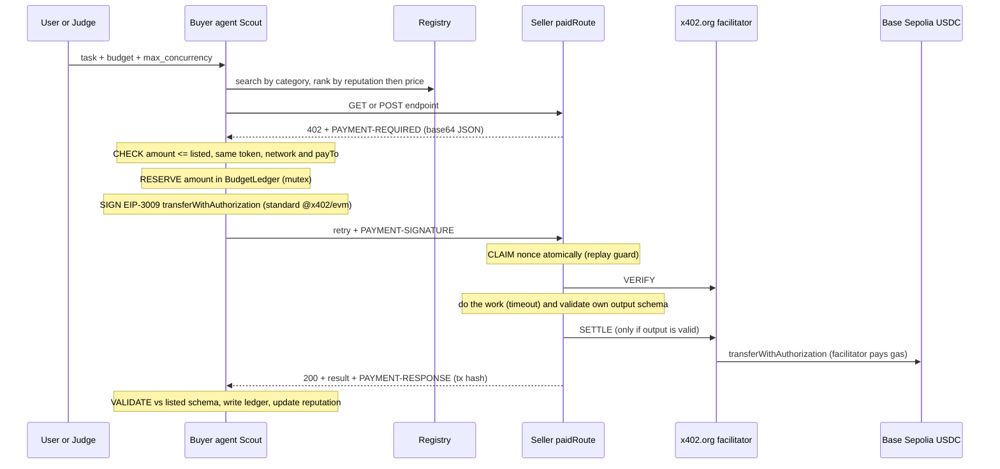
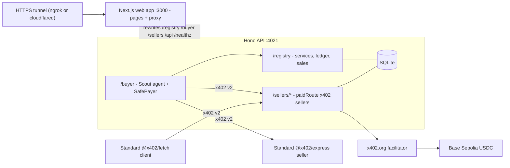

# Gandiva: Pay-per-call Agent Economy

A marketplace where AI agents hire other agents and pay **per request in USDC** using **x402 v2** HTTP payments on **Base Sepolia**. No API keys, no cards, no invoices: a seller answers `402 Payment Required`, the buyer signs an EIP-3009 authorisation, and the facilitator settles it on-chain. Every paid call has its own transaction hash.

- **Registry**: sellers list services (name, category, endpoint, price in USDC units, network, payTo, input/output JSON Schema, description). Search over HTTP or on the web page.
- **Sellers** (one per category, plus demo bad actors): `shelf-scraper` (scraping), `fx-rates` (data), `hindi-summary` (inference, Ollama LLM).
- **Buyer agent "Scout"**: takes a plain-language task and a budget, picks sellers by reputation and price, pays per request, validates and combines results, and explains what it bought, from whom, why, and at what cost.
- **Ledger + web app** (Next.js): every attempted call with status, amounts, tx hash (explorer link) and latency, plus a seller-side sales view.
- **Payment safety**: budget reservations under a mutex (safe at any concurrency), strict price/token/network/payTo check, single-use authorisations, no settlement unless the seller delivered valid output, schema checks on every response, and reputation that punishes junk.

## Architecture: where payments are checked, signed, verified, and settled





Code map:

| Concern | File |
|---|---|
| Seller-side x402 (nonce claim, verify, work, self-check, settle) | `src/x402/paidRoute.ts` |
| Buyer-side x402 (price check, reservation, sign, schema check, ledger) | `src/x402/safePayer.ts` |
| Budget reservations | `src/x402/budget.ts` |
| Registry, ledger, reputation | `src/registry/store.ts`, `src/registry/routes.ts` |
| Sellers | `src/sellers/index.ts`, `src/sellers/books.ts`, `src/sellers/fx.ts` |
| Buyer agent (planner, ranking, failover, receipt) | `src/buyer/planner.ts`, `src/buyer/scout.ts` |
| API app (Hono) | `src/server.ts` |
| Web app (Next.js 16, Tailwind v4): pages `/`, `/marketplace`, `/run`, `/ledger`, `/sales` | `client/` |
| API proxy rewrites | `client/next.config.ts` |
| One-command start (tunnel + API + web) | `scripts/start.ts` |

## Quick start

Requirements: Node 20+, a tunnel for public HTTPS ([ngrok](https://ngrok.com/download) with a free authtoken, or [cloudflared](https://developers.cloudflare.com/cloudflare-one/connections/connect-networks/downloads/)), and [Ollama](https://ollama.com) (local `ollama pull qwen2.5:7b`, or Ollama cloud via `OLLAMA_HOST=https://ollama.com` + `OLLAMA_API_KEY`).

```bash
npm install
cd client && npm install && cd ..   # Next.js web app dependencies (not `npm --prefix client install`, which adds the root package as a dependency)
cp .env.example .env
npm run wallets:new           # fresh testnet wallets into .env (gitignored); prints addresses only
# fund the buyer address with testnet USDC at https://faucet.circle.com (Base Sepolia). No ETH needed.
npm start                     # one command: tunnel + Hono API (:4021) + Next.js web app (:3000)
```

Two processes run behind one public URL:

| Process | Port | Env var | Role |
|---|---|---|---|
| Next.js web app (`client/`) | 3000 | `WEB_PORT` | Public front door and tunnel target. Serves the pages and proxies `/registry`, `/buyer`, `/sellers`, `/api` and `/healthz` to the API. |
| Hono API (`src/server.ts`) | 4021 | `PORT` (or `API_PORT`) | Registry, sellers, buyer agent, ledger. Internal only. |

`npm start` opens a tunnel to port 3000 (`TUNNEL=auto` tries cloudflared, then ngrok; set `TUNNEL=ngrok` or `TUNNEL=cloudflared` to pick one, and `NGROK_AUTHTOKEN` for ngrok). It then starts both processes with that public URL, so every registry listing and 402 `resource.url` is publicly reachable. If `PUBLIC_BASE_URL` is set, it skips the tunnel and uses that. With `TUNNEL=none` everything runs on `http://localhost:3000`. The x402 headers (`PAYMENT-REQUIRED`, `PAYMENT-SIGNATURE`, `PAYMENT-RESPONSE`) and status codes such as 402 pass through the Next.js proxy unchanged.

For development without a tunnel: `npm run dev:all` (API and web app with reload), or `npm run dev:api` and `npm run dev:web` separately. The CLI scripts (`npm run task`, the judge pack, `reconcile`) talk to the API directly on `http://localhost:4021`.

ngrok's free tier shows a warning page to browsers on first visit; click "Visit Site". curl and node clients are not affected.

## Public URLs (all on one host)

| What | Path |
|---|---|
| Web app: home, marketplace, run a task, ledger, sales | `/`, `/marketplace`, `/run`, `/ledger`, `/sales` |
| Health check | `/healthz` |
| Registry API | `/registry/services?category=&maxPrice=&sort=rank\|price\|latency` |
| Ledger API | `/registry/ledger` |
| Seller sales | `/registry/sales` |
| shelf-scraper (scraping, 0.005) | `GET /sellers/shelf-scraper/scrape?page=1` |
| fx-rates (data, 0.001) | `GET /sellers/fx-rates/rate?from=GBP&to=INR` |
| hindi-summary (inference, 0.010, up to 2 texts) | `POST /sellers/hindi-summary/summarise` `{"texts":["..."]}` |
| cheap-scraper (demo: 402 asks 10x listed) | `GET /sellers/cheap-scraper/scrape?page=1` |
| mirror-scraper (demo: 402 names another payTo) | `GET /sellers/mirror-scraper/scrape?page=1` |
| junk-fx (demo: 200 with schema-breaking output) | `GET /sellers/junk-fx/rate?from=GBP&to=INR` |
| Buyer: run a task | `POST /buyer/run` `{"task","budget","maxConcurrency"}` then `GET /buyer/runs/:id` |
| Buyer: buy one call in a category (with failover) | `POST /buyer/buy` `{"category","input","budget"}` |
| Buyer: pay one specific service | `POST /buyer/call` `{"serviceId","input","budget"}` |

## Testnet wallets (Base Sepolia)

| Role | Address |
|---|---|
| Buyer (Scout) | `0x2A6150F67b500EC856ac6c7ccEC4473fc53Fe5Ed` |
| shelf-scraper payTo | `0xf8ecD4f0048f3784F37A5C38f11DcD09CDB5dFa1` |
| cheap-scraper payTo | `0xF003c65A3d0e5Be293DEef3bf1cF2e0816016105` |
| fx-rates payTo | `0xa7bF4e3841a9CFd71B0159210aC977Bb9406Af80` |
| hindi-summary payTo | `0xabB7577aAa2E36A7F1eFB455991e2f81B74B7E0A` |
| junk-fx payTo | `0xFeF45Fd07E1E97174849548E8973944b674446B6` |
| mirror-scraper listed payTo | `0x324B377aAfA1aAFC0b121d4A4703910c9591d47F` |
| "attacker" payTo used by mirror-scraper's 402 | `0x5885c754a5Af918207d4A6161e558e25cE022D1D` |

USDC: `0x036CbD53842c5426634e7929541eC2318f3dCF7e` (6 decimals). Explorer: https://sepolia.basescan.org

## Three example tasks (each uses scraping + data + inference)

1. `From pages 1 to 4 of books.toscrape.com, find the three cheapest 5-star books, give their prices in rupees, and summarise each description in Hindi.` Budget 0.050.
2. `From pages 2 to 3 of books.toscrape.com, find the two most expensive 1-star books, give their prices in euros, and summarise each description in Hindi.` Budget 0.030.
3. `From pages 5 to 6 of books.toscrape.com, find the four cheapest books rated at least 4 stars, give their prices in yen, and summarise each description in Hindi.` Budget 0.040.

Change any number (pages, count, star rating, currency, budget) on the spot. Numbers are parsed deterministically; the LLM only fills gaps. Summaries are batched 2 texts per call to save budget.

```bash
npm run task -- "From pages 1 to 4 of books.toscrape.com, find the three cheapest 5-star books, give their prices in rupees, and summarise each description in Hindi." 0.05 3
```

## Judge test pack

| Test | Command | What it shows |
|---|---|---|
| Happy path | `npm run task -- "<task>" 0.05 3` or the `/run` page | 3+ paid calls, each with its own tx to the seller's payTo |
| Reconciliation | `npm run reconcile` | per-tx check (buyer to payTo, exact amount) and a full log scan of USDC out of the buyer, both equal to the ledger total (payments made directly by our test scripts are listed separately from the seller sales log) |
| Budget | `npm run judge:budget` | 0.012 budget at max_concurrency 1 and 5: never overspends, stops and says how much more it needs |
| Price check | `npm run judge:price` | standard-SDK sellers asking 10x, or naming another payTo, are refused with 0 paid |
| Replay | `npm run judge:replay` | one signature sent twice, then 5x in parallel: exactly one 200 and one tx each |
| Seller failure | `npm run judge:failure` | paid request for page 999: error back, no PAYMENT-RESPONSE, balance unchanged |
| Junk output | `npm run judge:junk` | standard-SDK seller returns junk: paid, output rejected, reputation drops, buyer buys elsewhere |
| Standard client | `npm run interop:ref-buyer` and `npm run judge:interop` | unmodified `@x402/fetch` pays our seller; our buyer pays an unmodified `@x402/express` seller |
| Key hygiene | `gitleaks detect` | keys only in `.env` (gitignored); the web app only receives addresses; logs never print keys or signatures |

To register your own reference seller, `POST /registry/services`:

```json
{
  "name": "ref-seller", "category": "data", "endpoint": "https://your-host/rate", "method": "GET",
  "price": "1000", "payTo": "0x...",
  "inputSchema": {"type":"object","properties":{"from":{"type":"string"},"to":{"type":"string"}}},
  "outputSchema": {"type":"object","required":["rate"],"properties":{"rate":{"type":"number"}}},
  "description": "..."
}
```

Then `POST /buyer/call {"serviceId":"ref-seller","input":{...}}` or `POST /buyer/buy {"category":"data","input":{...}}`.

## How the safety rules are enforced

- **Budget**: every call must `reserve()` its amount in a shared `BudgetLedger` before signing. `spent + reserved + amount <= budget` is checked under a mutex, so parallel calls can never overspend. Failed calls release their reservation; settled calls commit it. Budget refusals are recorded in the ledger with the reason.
- **Price check**: the 402's `accepts` must match the registry listing: scheme `exact`, same network, same token, same payTo, and amount no higher than the listed price. Otherwise Scout refuses without signing.
- **Replay**: before verifying, the seller claims the EIP-3009 authorisation nonce with a unique-key insert. Copies, sequential or parallel, get `409`. USDC itself also rejects a reused nonce on-chain.
- **No service, no charge**: the seller verifies, runs the handler with a timeout, validates its own output against its schema, and only then settles. Errors, timeouts and invalid output return an error without settling.
- **Bad output**: Scout validates every 200 against the listed output schema (Ajv). Junk is recorded as `paid_output_rejected`, discarded, counts against the seller's reputation, and Scout tries the next seller if budget allows.
- **Reputation**: success rate (clean paid calls / attempts), median latency and price per service, computed from the ledger. Ranking: optimistic score `(successes+1)/(attempts+1)` first, then price, then latency.

## Rules compliance

Testnet only (Base Sepolia, `eip155:84532`). Prices are at most 0.10 USDC per call, enforced by the registry. Scraping targets only books.toscrape.com, and the scraper checks robots.txt. Settlement goes through the x402.org testnet facilitator.
